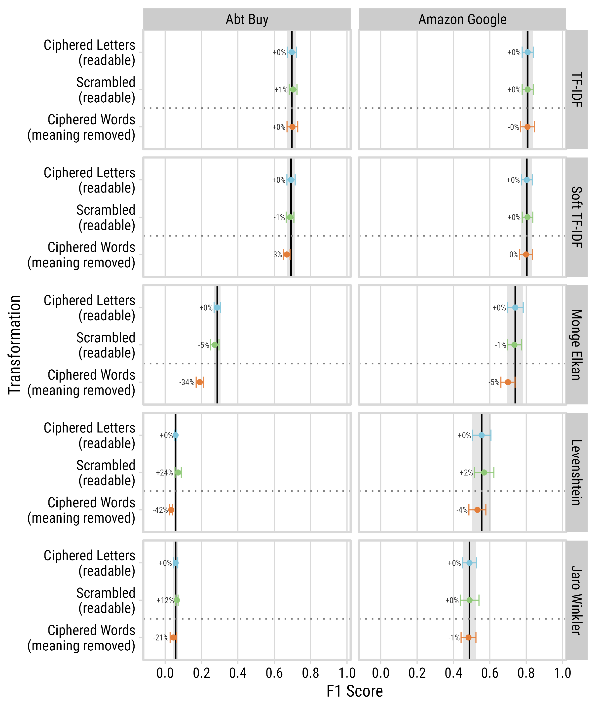

<!-- README.md is generated from README.qmd. Edit README.qmd, then run: quarto render README.qmd -->

# Matching Without Meaning

**Do LLM entity matchers fall back on lexical evidence when the meaning
is removed?**

LLM entity matchers lean on semantics. We test what happens when meaning
is removed but the lexical evidence that identifies a match is kept.
TF-IDF is the control: it sees the same evidence in every condition, so
its F1 does not move, which shows that evidence alone still solves the
task.

> **Status.** This README is rendered from `README.qmd` and reads every
> number from `results/` and `data/`.
>
> - The non-LLM methods were rerun on 2026-11-08 with the current code,
>   on all seven conditions.
> - `openai_embeddings` has not been rerun yet (it is a paid call), so
>   its rows still come from the earlier code.
> - Harness v2 LLM runs: some results are in (see below). The main
>   results use the small models (Claude Haiku 5.5, GPT-6 Luna). Claude
>   Sonnet 5.5 is a scale check, reported in [its own appendix
>   section](#appendix-scale-check-claude-sonnet-55).
> - The v1 LLM results from the TKDE submission are superseded. They
>   appear in the figures labeled “(v1)” and in [their own
>   section](#v1-llm-results-superseded).

## Research question

Does an LLM entity matcher use the evidence that actually distinguishes
entities, or does it depend on meaning the task does not require?

We use *controlled semantic ablation*: transforms that remove meaning
while keeping each token’s identity across the two catalogs intact. A
method that relies only on which tokens the two records share is
unaffected. A method that relies on meaning degrades.

### The v1 transforms

1.  **Original**: the baseline.
2.  **Ciphered Letters**: one consistent character substitution applied
    to both catalogs (for example ‘a’ becomes ‘x’).
3.  **Ciphered Words**: one consistent word replacement applied to both
    catalogs (for example ‘Sony’ becomes ‘Goat’).
4.  **Scrambled**: a deterministic letter scramble within each word,
    first and last letters kept, identical across catalogs.

### The 2x2 factorial: descriptive words x identifiers

|                           | identifiers intact | identifiers ciphered |
|---------------------------|--------------------|----------------------|
| **descriptions intact**   | `original`         | `ids_ciphered`       |
| **descriptions ciphered** | `desc_ciphered`    | `all_ciphered`       |

- **Identifiers** are model numbers and SKUs: pieces that contain both a
  letter and a digit (`w55`, `pslx350h`), plus short non-English
  prefixes attached to them (`dsc` in `dsc-w55`). Quantities (`4gb`,
  `1080p`) are not identifiers, and neither are pieces that appear in
  more than 20 records.
- **Descriptive words** are everything else, including brand names.
- Descriptive words become pronounceable nonce words of the same length
  that are not English words. Identifiers become random codes of the
  same shape. Both maps are global and injective, so TF-IDF scores are
  identical in every cell (checked to 1e-9 by
  `02_prepare_factorial.py --verify`).

Identifier coverage (seed 42, from `factorial_manifest.json`): on
Abt-Buy, 49.8% of true pairs share an identifier piece and 42.6% share
one that occurs in no other record. On Amazon-Google the shares are 4.4%
and 0.8%, so the identifier factor mainly matters on Abt-Buy.

## Results

All F1, precision, and recall values use 5-fold cross-validated
thresholds (`results/cv_results.csv`).

### Overview figures


*F1 under each v1 transform for the semantic methods (Haiku 5.5 and
GPT-6 Luna on harness v2, plus the two embedding models). Solid line and
grey band: the method’s own Original F1 (± 1 SD across folds). Dashed
red line: TF-IDF F1 on Original, the lexical control. Ciphered Letters
and Scrambled are “readable”: the decode test (`09_decode_test.py`)
shows a capable model can recover the text. Ciphered Words removes
meaning; it sits below the dotted divider.*


*Precision and recall at the cross-validated threshold. Red diamonds:
TF-IDF in each condition (they coincide, because TF-IDF is invariant).
The legend marks each condition as readable or meaning removed.*

### F1 by method and condition

The semantic methods, with TF-IDF as the lexical control. Across all
seven conditions, TF-IDF F1 ranges from 0.696 to 0.704 on Abt-Buy and
from 0.807 to 0.808 on Amazon-Google.

**Abt-Buy** (name + description):

| Method              | Original | Ciphered Letters | Ciphered Words | Scrambled |
|:--------------------|---------:|-----------------:|---------------:|----------:|
| Claude Haiku 5.5    |    0.953 |            0.055 |          0.313 |     0.057 |
| GPT-6 Luna          |    0.966 |            0.932 |          0.701 |     0.881 |
| OpenAI Embeddings   |    0.787 |            0.343 |          0.354 |     0.469 |
| SentenceTransformer |    0.583 |            0.149 |          0.348 |     0.359 |
| TF-IDF              |    0.697 |            0.697 |          0.700 |     0.704 |

**Amazon-Google** (title only):

| Method              | Original | Ciphered Letters | Ciphered Words | Scrambled |
|:--------------------|---------:|-----------------:|---------------:|----------:|
| Claude Haiku 5.5    |    0.896 |            0.167 |          0.713 |     0.847 |
| GPT-6 Luna          |    0.911 |            0.872 |          0.839 |     0.901 |
| OpenAI Embeddings   |    0.802 |            0.638 |          0.701 |     0.725 |
| SentenceTransformer |    0.755 |            0.617 |          0.683 |     0.675 |
| TF-IDF              |    0.808 |            0.808 |          0.807 |     0.808 |

### Precision, recall, and F1 on Original

**Abt-Buy:**

| Method              | Precision | Recall |    F1 | F1 SD (5 folds) |
|:--------------------|----------:|-------:|------:|----------------:|
| Claude Haiku 5.5    |     0.985 |  0.922 | 0.953 |           0.010 |
| GPT-6 Luna          |     0.989 |  0.944 | 0.966 |           0.006 |
| OpenAI Embeddings   |     0.787 |  0.787 | 0.787 |           0.021 |
| SentenceTransformer |     0.584 |  0.581 | 0.583 |           0.027 |
| TF-IDF              |     0.705 |  0.689 | 0.697 |           0.025 |

**Amazon-Google:**

| Method              | Precision | Recall |    F1 | F1 SD (5 folds) |
|:--------------------|----------:|-------:|------:|----------------:|
| Claude Haiku 5.5    |     0.931 |  0.864 | 0.896 |           0.019 |
| GPT-6 Luna          |     0.924 |  0.898 | 0.911 |           0.005 |
| OpenAI Embeddings   |     0.803 |  0.801 | 0.802 |           0.028 |
| SentenceTransformer |     0.759 |  0.751 | 0.755 |           0.040 |
| TF-IDF              |     0.808 |  0.808 | 0.808 |           0.030 |

### 2x2 factorial

F1 in each cell of the descriptive-words x identifiers design.


*One line per description state, across identifiers intact or ciphered.
Dashed red line: TF-IDF F1, identical in every cell.*

**Abt-Buy:**

| Method | Original | Descriptions ciphered | Identifiers ciphered | Both ciphered |
|:---|---:|---:|---:|---:|
| Claude Haiku 5.5 | 0.953 | 0.870 | 0.778 | 0.652 |
| GPT-6 Luna | 0.966 | 0.919 | 0.824 | 0.745 |
| OpenAI Embeddings | 0.787 | 0.576 | 0.699 | 0.432 |
| SentenceTransformer | 0.583 | 0.362 | 0.526 | 0.300 |
| TF-IDF | 0.697 | 0.697 | 0.697 | 0.696 |

**Amazon-Google:**

| Method | Original | Descriptions ciphered | Identifiers ciphered | Both ciphered |
|:---|---:|---:|---:|---:|
| Claude Haiku 5.5 | 0.896 | 0.705 | 0.885 | 0.693 |
| GPT-6 Luna | 0.911 | 0.849 | 0.902 | 0.845 |
| OpenAI Embeddings | 0.802 | 0.672 | 0.795 | 0.671 |
| SentenceTransformer | 0.755 | 0.671 | 0.742 | 0.665 |
| TF-IDF | 0.808 | 0.808 | 0.808 | 0.808 |

### Candidate-list robustness

The main design shows the LLM the TF-IDF top 50 candidates in rank
order. One check shortens the list to the top 10, still in rank order
(`__k10`), to test whether list length explains the drop.


| Dataset | Method | Original | Ciphered Letters | Ciphered Words | Scrambled |
|:---|:---|:---|:---|:---|:---|
| Abt-Buy | llm_gpt6luna | 0.966 | 0.932 | 0.701 | 0.881 |
| Abt-Buy | llm_gpt6luna\_\_k10 | 0.938 | 0.904 | 0.697 | 0.873 |
| Abt-Buy | llm_haiku55 | 0.953 | 0.055 | 0.313 | 0.057 |
| Abt-Buy | llm_haiku55\_\_k10 | 0.925 | 0.069 | 0.370 | 0.111 |
| Amazon-Google | llm_gpt6luna | 0.911 | 0.872 | 0.839 | 0.901 |
| Amazon-Google | llm_gpt6luna\_\_k10 | 0.909 | 0.860 | 0.836 | 0.898 |
| Amazon-Google | llm_haiku55 | 0.896 | 0.167 | 0.713 | 0.847 |
| Amazon-Google | llm_haiku55\_\_k10 | 0.890 | 0.374 | 0.706 | 0.843 |

### LLM output status

Share of rows by status (`ok`, `no_match`, `parse_fail`, `truncated`,
`refusal`, `api_error`). Parse failures are reported as their own
outcome, never counted as “no match”.

| dataset | method | transformation | n | ok | no_match | parse_fail | truncated | refusal | api_error |
|:---|:---|:---|---:|---:|---:|---:|---:|---:|---:|
| abt-buy | llm_gpt6luna | all_ciphered | 1081 | 0.7364 | 0.2636 | 0 | 0 | 0.0000 | 0 |
| abt-buy | llm_gpt6luna | ciphered_letters | 1081 | 0.9537 | 0.0463 | 0 | 0 | 0.0000 | 0 |
| abt-buy | llm_gpt6luna | ciphered_words | 1081 | 0.9223 | 0.0777 | 0 | 0 | 0.0000 | 0 |
| abt-buy | llm_gpt6luna | desc_ciphered | 1081 | 0.9130 | 0.0870 | 0 | 0 | 0.0000 | 0 |
| abt-buy | llm_gpt6luna | ids_ciphered | 1081 | 0.7993 | 0.2007 | 0 | 0 | 0.0000 | 0 |
| abt-buy | llm_gpt6luna | original | 1081 | 0.9648 | 0.0352 | 0 | 0 | 0.0000 | 0 |
| abt-buy | llm_gpt6luna | scrambled | 1081 | 0.9130 | 0.0870 | 0 | 0 | 0.0000 | 0 |
| abt-buy | llm_gpt6luna\_\_k10 | ciphered_letters | 1081 | 0.9297 | 0.0703 | 0 | 0 | 0.0000 | 0 |
| abt-buy | llm_gpt6luna\_\_k10 | ciphered_words | 1081 | 0.8918 | 0.1082 | 0 | 0 | 0.0000 | 0 |
| abt-buy | llm_gpt6luna\_\_k10 | original | 1081 | 0.9158 | 0.0842 | 0 | 0 | 0.0000 | 0 |
| abt-buy | llm_gpt6luna\_\_k10 | scrambled | 1081 | 0.9001 | 0.0999 | 0 | 0 | 0.0000 | 0 |
| abt-buy | llm_gpt6luna\_\_rep1 | ciphered_letters | 1081 | 0.9473 | 0.0527 | 0 | 0 | 0.0000 | 0 |
| abt-buy | llm_gpt6luna\_\_rep1 | ciphered_words | 1081 | 0.9315 | 0.0685 | 0 | 0 | 0.0000 | 0 |
| abt-buy | llm_gpt6luna\_\_rep1 | original | 1081 | 0.9667 | 0.0333 | 0 | 0 | 0.0000 | 0 |
| abt-buy | llm_gpt6luna\_\_rep1 | scrambled | 1081 | 0.9214 | 0.0786 | 0 | 0 | 0.0000 | 0 |
| abt-buy | llm_gpt6luna\_\_rep2 | ciphered_letters | 1081 | 0.9482 | 0.0518 | 0 | 0 | 0.0000 | 0 |
| abt-buy | llm_gpt6luna\_\_rep2 | ciphered_words | 1081 | 0.9204 | 0.0796 | 0 | 0 | 0.0000 | 0 |
| abt-buy | llm_gpt6luna\_\_rep2 | original | 1081 | 0.9611 | 0.0389 | 0 | 0 | 0.0000 | 0 |
| abt-buy | llm_gpt6luna\_\_rep2 | scrambled | 1081 | 0.9195 | 0.0805 | 0 | 0 | 0.0000 | 0 |
| abt-buy | llm_gpt6luna_tf | ciphered_letters | 1081 | 0.9824 | 0.0176 | 0 | 0 | 0.0000 | 0 |
| abt-buy | llm_gpt6luna_tf | ciphered_words | 1081 | 0.9639 | 0.0361 | 0 | 0 | 0.0000 | 0 |
| abt-buy | llm_gpt6luna_tf | original | 1081 | 0.9759 | 0.0241 | 0 | 0 | 0.0000 | 0 |
| abt-buy | llm_gpt6luna_tf | scrambled | 1081 | 0.9445 | 0.0555 | 0 | 0 | 0.0000 | 0 |
| abt-buy | llm_haiku55 | all_ciphered | 1081 | 0.5032 | 0.4746 | 0 | 0 | 0.0222 | 0 |
| abt-buy | llm_haiku55 | ciphered_letters | 1081 | 0.0333 | 0.0019 | 0 | 0 | 0.9648 | 0 |
| abt-buy | llm_haiku55 | ciphered_words | 1081 | 0.2276 | 0.3016 | 0 | 0 | 0.4709 | 0 |
| abt-buy | llm_haiku55 | desc_ciphered | 1081 | 0.8020 | 0.1628 | 0 | 0 | 0.0352 | 0 |
| abt-buy | llm_haiku55 | ids_ciphered | 1081 | 0.6929 | 0.3071 | 0 | 0 | 0.0000 | 0 |
| abt-buy | llm_haiku55 | original | 1081 | 0.9362 | 0.0638 | 0 | 0 | 0.0000 | 0 |
| abt-buy | llm_haiku55 | scrambled | 1081 | 0.0296 | 0.0037 | 0 | 0 | 0.9667 | 0 |
| abt-buy | llm_haiku55\_\_k10 | ciphered_letters | 1081 | 0.0407 | 0.0019 | 0 | 0 | 0.9574 | 0 |
| abt-buy | llm_haiku55\_\_k10 | ciphered_words | 1081 | 0.2886 | 0.4746 | 0 | 0 | 0.2368 | 0 |
| abt-buy | llm_haiku55\_\_k10 | original | 1081 | 0.9001 | 0.0999 | 0 | 0 | 0.0000 | 0 |
| abt-buy | llm_haiku55\_\_k10 | scrambled | 1081 | 0.0657 | 0.0102 | 0 | 0 | 0.9241 | 0 |
| abt-buy | llm_haiku55\_\_rep1 | ciphered_letters | 1081 | 0.0296 | 0.0028 | 0 | 0 | 0.9676 | 0 |
| abt-buy | llm_haiku55\_\_rep1 | ciphered_words | 1081 | 0.2442 | 0.3006 | 0 | 0 | 0.4551 | 0 |
| abt-buy | llm_haiku55\_\_rep1 | original | 1081 | 0.9380 | 0.0620 | 0 | 0 | 0.0000 | 0 |
| abt-buy | llm_haiku55\_\_rep1 | scrambled | 1081 | 0.0268 | 0.0056 | 0 | 0 | 0.9676 | 0 |
| abt-buy | llm_haiku55\_\_rep2 | ciphered_words | 1081 | 0.2211 | 0.3043 | 0 | 0 | 0.4746 | 0 |
| abt-buy | llm_haiku55\_\_rep2 | original | 1081 | 0.9352 | 0.0648 | 0 | 0 | 0.0000 | 0 |
| abt-buy | llm_haiku55_tf | ciphered_letters | 1081 | 0.0278 | 0.0009 | 0 | 0 | 0.9713 | 0 |
| abt-buy | llm_haiku55_tf | ciphered_words | 1081 | 0.0981 | 0.0315 | 0 | 0 | 0.8705 | 0 |
| abt-buy | llm_haiku55_tf | original | 1081 | 0.9593 | 0.0407 | 0 | 0 | 0.0000 | 0 |
| abt-buy | llm_haiku55_tf | scrambled | 1081 | 0.0130 | 0.0009 | 0 | 0 | 0.9861 | 0 |
| abt-buy | llm_sonnet55 | all_ciphered | 324 | 0.5432 | 0.4537 | 0 | 0 | 0.0031 | 0 |
| abt-buy | llm_sonnet55 | ciphered_letters | 324 | 0.5710 | 0.0679 | 0 | 0 | 0.3611 | 0 |
| abt-buy | llm_sonnet55 | ciphered_words | 324 | 0.3920 | 0.4599 | 0 | 0 | 0.1481 | 0 |
| abt-buy | llm_sonnet55 | desc_ciphered | 324 | 0.7932 | 0.2068 | 0 | 0 | 0.0000 | 0 |
| abt-buy | llm_sonnet55 | ids_ciphered | 324 | 0.7130 | 0.2870 | 0 | 0 | 0.0000 | 0 |
| abt-buy | llm_sonnet55 | original | 324 | 0.9136 | 0.0864 | 0 | 0 | 0.0000 | 0 |
| abt-buy | llm_sonnet55 | scrambled | 324 | 0.5247 | 0.1327 | 0 | 0 | 0.3426 | 0 |
| amazon-google | llm_gpt6luna | all_ciphered | 1113 | 0.9272 | 0.0728 | 0 | 0 | 0.0000 | 0 |
| amazon-google | llm_gpt6luna | ciphered_letters | 1113 | 0.9659 | 0.0341 | 0 | 0 | 0.0000 | 0 |
| amazon-google | llm_gpt6luna | ciphered_words | 1113 | 0.9488 | 0.0512 | 0 | 0 | 0.0000 | 0 |
| amazon-google | llm_gpt6luna | desc_ciphered | 1113 | 0.9389 | 0.0611 | 0 | 0 | 0.0000 | 0 |
| amazon-google | llm_gpt6luna | ids_ciphered | 1113 | 0.9614 | 0.0386 | 0 | 0 | 0.0000 | 0 |
| amazon-google | llm_gpt6luna | original | 1113 | 0.9712 | 0.0288 | 0 | 0 | 0.0000 | 0 |
| amazon-google | llm_gpt6luna | scrambled | 1113 | 0.9668 | 0.0332 | 0 | 0 | 0.0000 | 0 |
| amazon-google | llm_gpt6luna\_\_k10 | ciphered_letters | 1113 | 0.9488 | 0.0512 | 0 | 0 | 0.0000 | 0 |
| amazon-google | llm_gpt6luna\_\_k10 | ciphered_words | 1113 | 0.9039 | 0.0961 | 0 | 0 | 0.0000 | 0 |
| amazon-google | llm_gpt6luna\_\_k10 | original | 1113 | 0.9569 | 0.0431 | 0 | 0 | 0.0000 | 0 |
| amazon-google | llm_gpt6luna\_\_k10 | scrambled | 1113 | 0.9614 | 0.0386 | 0 | 0 | 0.0000 | 0 |
| amazon-google | llm_gpt6luna\_\_rep1 | ciphered_letters | 1113 | 0.9587 | 0.0413 | 0 | 0 | 0.0000 | 0 |
| amazon-google | llm_gpt6luna\_\_rep1 | ciphered_words | 1113 | 0.9416 | 0.0584 | 0 | 0 | 0.0000 | 0 |
| amazon-google | llm_gpt6luna\_\_rep1 | original | 1113 | 0.9677 | 0.0323 | 0 | 0 | 0.0000 | 0 |
| amazon-google | llm_gpt6luna\_\_rep1 | scrambled | 1113 | 0.9677 | 0.0323 | 0 | 0 | 0.0000 | 0 |
| amazon-google | llm_gpt6luna\_\_rep2 | ciphered_letters | 1113 | 0.9712 | 0.0288 | 0 | 0 | 0.0000 | 0 |
| amazon-google | llm_gpt6luna\_\_rep2 | ciphered_words | 1113 | 0.9362 | 0.0638 | 0 | 0 | 0.0000 | 0 |
| amazon-google | llm_gpt6luna\_\_rep2 | original | 1113 | 0.9686 | 0.0314 | 0 | 0 | 0.0000 | 0 |
| amazon-google | llm_gpt6luna\_\_rep2 | scrambled | 1113 | 0.9650 | 0.0350 | 0 | 0 | 0.0000 | 0 |
| amazon-google | llm_gpt6luna_tf | ciphered_letters | 1113 | 0.9928 | 0.0072 | 0 | 0 | 0.0000 | 0 |
| amazon-google | llm_gpt6luna_tf | ciphered_words | 1113 | 0.9757 | 0.0243 | 0 | 0 | 0.0000 | 0 |
| amazon-google | llm_gpt6luna_tf | original | 1113 | 0.9892 | 0.0108 | 0 | 0 | 0.0000 | 0 |
| amazon-google | llm_gpt6luna_tf | scrambled | 1113 | 0.9847 | 0.0153 | 0 | 0 | 0.0000 | 0 |
| amazon-google | llm_haiku55 | all_ciphered | 1113 | 0.6038 | 0.3935 | 0 | 0 | 0.0027 | 0 |
| amazon-google | llm_haiku55 | ciphered_letters | 1113 | 0.1069 | 0.0386 | 0 | 0 | 0.8544 | 0 |
| amazon-google | llm_haiku55 | ciphered_words | 1113 | 0.6478 | 0.3522 | 0 | 0 | 0.0000 | 0 |
| amazon-google | llm_haiku55 | desc_ciphered | 1113 | 0.6137 | 0.3827 | 0 | 0 | 0.0036 | 0 |
| amazon-google | llm_haiku55 | ids_ciphered | 1113 | 0.9137 | 0.0863 | 0 | 0 | 0.0000 | 0 |
| amazon-google | llm_haiku55 | original | 1113 | 0.9344 | 0.0656 | 0 | 0 | 0.0000 | 0 |
| amazon-google | llm_haiku55 | scrambled | 1113 | 0.8410 | 0.1195 | 0 | 0 | 0.0395 | 0 |
| amazon-google | llm_haiku55\_\_k10 | ciphered_letters | 1113 | 0.2633 | 0.1321 | 0 | 0 | 0.6047 | 0 |
| amazon-google | llm_haiku55\_\_k10 | ciphered_words | 1113 | 0.6523 | 0.3477 | 0 | 0 | 0.0000 | 0 |
| amazon-google | llm_haiku55\_\_k10 | original | 1113 | 0.9057 | 0.0943 | 0 | 0 | 0.0000 | 0 |
| amazon-google | llm_haiku55\_\_k10 | scrambled | 1113 | 0.8374 | 0.1258 | 0 | 0 | 0.0368 | 0 |
| amazon-google | llm_haiku55\_\_rep1 | ciphered_words | 1113 | 0.6433 | 0.3567 | 0 | 0 | 0.0000 | 0 |
| amazon-google | llm_haiku55\_\_rep1 | original | 1113 | 0.9335 | 0.0665 | 0 | 0 | 0.0000 | 0 |
| amazon-google | llm_haiku55\_\_rep1 | scrambled | 1113 | 0.8464 | 0.1150 | 0 | 0 | 0.0386 | 0 |
| amazon-google | llm_haiku55\_\_rep2 | ciphered_words | 1113 | 0.6451 | 0.3549 | 0 | 0 | 0.0000 | 0 |
| amazon-google | llm_haiku55\_\_rep2 | original | 1113 | 0.9299 | 0.0701 | 0 | 0 | 0.0000 | 0 |
| amazon-google | llm_haiku55\_\_rep2 | scrambled | 1113 | 0.8410 | 0.1177 | 0 | 0 | 0.0413 | 0 |
| amazon-google | llm_haiku55_tf | ciphered_letters | 1113 | 0.0970 | 0.0054 | 0 | 0 | 0.8976 | 0 |
| amazon-google | llm_haiku55_tf | ciphered_words | 1113 | 0.8419 | 0.1554 | 0 | 0 | 0.0027 | 0 |
| amazon-google | llm_haiku55_tf | original | 1113 | 0.9668 | 0.0332 | 0 | 0 | 0.0000 | 0 |
| amazon-google | llm_haiku55_tf | scrambled | 1113 | 0.8607 | 0.0620 | 0 | 0 | 0.0773 | 0 |
| amazon-google | llm_sonnet55 | all_ciphered | 334 | 0.6946 | 0.3054 | 0 | 0 | 0.0000 | 0 |
| amazon-google | llm_sonnet55 | ciphered_letters | 334 | 0.5419 | 0.1737 | 0 | 0 | 0.2844 | 0 |
| amazon-google | llm_sonnet55 | ciphered_words | 334 | 0.6886 | 0.3114 | 0 | 0 | 0.0000 | 0 |
| amazon-google | llm_sonnet55 | desc_ciphered | 334 | 0.6707 | 0.3293 | 0 | 0 | 0.0000 | 0 |
| amazon-google | llm_sonnet55 | ids_ciphered | 334 | 0.9192 | 0.0808 | 0 | 0 | 0.0000 | 0 |
| amazon-google | llm_sonnet55 | original | 334 | 0.9371 | 0.0629 | 0 | 0 | 0.0000 | 0 |
| amazon-google | llm_sonnet55 | scrambled | 334 | 0.8353 | 0.1407 | 0 | 0 | 0.0240 | 0 |

### Shortlist recall

Share of queries whose true match is in the TF-IDF top-k shortlist.

| dataset | transformation | n | recall_at_1 | recall_at_5 | recall_at_10 | recall_at_20 | recall_at_50 |
|:---|:---|---:|---:|---:|---:|---:|---:|
| abt-buy | original | 1081 | 0.6928770 | 0.9019426 | 0.9481961 | 0.9814986 | 0.9916744 |
| abt-buy | ciphered_letters | 1081 | 0.6928770 | 0.9019426 | 0.9481961 | 0.9814986 | 0.9916744 |
| abt-buy | ciphered_words | 1081 | 0.7021277 | 0.8963922 | 0.9500463 | 0.9814986 | 0.9907493 |
| abt-buy | scrambled | 1081 | 0.6975023 | 0.9010176 | 0.9500463 | 0.9814986 | 0.9907493 |
| abt-buy | desc_ciphered | 1081 | 0.6928770 | 0.9019426 | 0.9481961 | 0.9814986 | 0.9916744 |
| abt-buy | ids_ciphered | 1081 | 0.6919519 | 0.9019426 | 0.9481961 | 0.9814986 | 0.9916744 |
| abt-buy | all_ciphered | 1081 | 0.6919519 | 0.9019426 | 0.9481961 | 0.9814986 | 0.9916744 |
| amazon-google | original | 1113 | 0.8068284 | 0.9595687 | 0.9856244 | 0.9919137 | 0.9946092 |
| amazon-google | ciphered_letters | 1113 | 0.8068284 | 0.9595687 | 0.9856244 | 0.9919137 | 0.9946092 |
| amazon-google | ciphered_words | 1113 | 0.8050314 | 0.9604672 | 0.9838275 | 0.9919137 | 0.9946092 |
| amazon-google | scrambled | 1113 | 0.8068284 | 0.9595687 | 0.9856244 | 0.9919137 | 0.9946092 |
| amazon-google | desc_ciphered | 1113 | 0.8068284 | 0.9595687 | 0.9856244 | 0.9919137 | 0.9946092 |
| amazon-google | ids_ciphered | 1113 | 0.8068284 | 0.9595687 | 0.9856244 | 0.9919137 | 0.9946092 |
| amazon-google | all_ciphered | 1113 | 0.8068284 | 0.9595687 | 0.9856244 | 0.9919137 | 0.9946092 |

### Instance-level analysis

Including the share of LLM misses where the true pair shares an
identifier piece that no other candidate has.

| dataset | method | transformation | n | rate_ok | rate_no_match | rate_refusal | rate_parse_fail | rate_truncated | rate_api_error | n_candidates | shortlist_recall | tfidf_top1_correct | llm_correct | picked_top1 | both | llm_only | tfidf_only | neither | f1_all | f1_in_shortlist | uid_share | llm_correct_uid | tfidf_top1_correct_uid | miss_uid_share | misses_answered_uid_share | mean_input_tokens | spearman_tokens_correct |
|:---|:---|:---|---:|---:|---:|---:|---:|---:|---:|---:|---:|---:|---:|---:|---:|---:|---:|---:|---:|---:|---:|---:|---:|---:|---:|---:|---:|
| abt-buy | llm_gpt6luna | original | 1081 | 0.9648474 | 0.0351526 | 0.0000000 | 0 | 0 | 0 | 50 | 0.9916744 | 0.6928770 | 0.9454209 | 0.7171620 | 0.6808511 | 0.2645698 | 0.0120259 | 0.0425532 | 0.9658939 | 0.9694816 | 0.4347826 | 0.9957447 | 0.9297872 | 0.0338983 | 0.0338983 | 1329.5920 | 0.0933934 |
| abt-buy | llm_gpt6luna | ciphered_letters | 1081 | 0.9537465 | 0.0462535 | 0.0000000 | 0 | 0 | 0 | 50 | 0.9916744 | 0.6928770 | 0.9074931 | 0.7177498 | 0.6623497 | 0.2451434 | 0.0305273 | 0.0619796 | 0.9320669 | 0.9370290 | 0.4347826 | 0.9936170 | 0.9297872 | 0.0300000 | 0.0300000 | 2035.0407 | 0.0546250 |
| abt-buy | llm_gpt6luna | ciphered_words | 1081 | 0.9222942 | 0.0777058 | 0.0000000 | 0 | 0 | 0 | 50 | 0.9907493 | 0.7021277 | 0.6410731 | 0.7813440 | 0.5883441 | 0.0527290 | 0.1137835 | 0.2451434 | 0.7005943 | 0.7065051 | 0.4347826 | 0.8680851 | 0.9361702 | 0.1597938 | 0.1597938 | 1445.1027 | 0.0167198 |
| abt-buy | llm_gpt6luna | scrambled | 1081 | 0.9130435 | 0.0869565 | 0.0000000 | 0 | 0 | 0 | 50 | 0.9907493 | 0.6975023 | 0.8436633 | 0.7720365 | 0.6669750 | 0.1766883 | 0.0305273 | 0.1258094 | 0.8811192 | 0.8865208 | 0.4347826 | 0.9723404 | 0.9361702 | 0.0769231 | 0.0769231 | 1847.8344 | 0.0657738 |
| abt-buy | llm_gpt6luna | desc_ciphered | 1081 | 0.9130435 | 0.0869565 | 0.0000000 | 0 | 0 | 0 | 50 | 0.9916744 | 0.6928770 | 0.8788159 | 0.7254306 | 0.6429232 | 0.2358927 | 0.0499537 | 0.0712303 | 0.9185751 | 0.9231674 | 0.4347826 | 0.9978723 | 0.9297872 | 0.0076336 | 0.0076336 | 1780.6420 | 0.0339236 |
| abt-buy | llm_gpt6luna | ids_ciphered | 1081 | 0.7992599 | 0.2007401 | 0.0000000 | 0 | 0 | 0 | 50 | 0.9916744 | 0.6919519 | 0.7354302 | 0.8263889 | 0.6318224 | 0.1036078 | 0.0601295 | 0.2044403 | 0.8238320 | 0.8276664 | 0.4347826 | 0.9957447 | 0.9297872 | 0.0069930 | 0.0069930 | 1332.7808 | 0.0805148 |
| abt-buy | llm_gpt6luna | all_ciphered | 1081 | 0.7363552 | 0.2636448 | 0.0000000 | 0 | 0 | 0 | 50 | 0.9916744 | 0.6919519 | 0.6392229 | 0.8592965 | 0.5735430 | 0.0656799 | 0.1184089 | 0.2423682 | 0.7447447 | 0.7478823 | 0.4347826 | 0.9808511 | 0.9297872 | 0.0230769 | 0.0230769 | 1783.8316 | 0.1065117 |
| abt-buy | llm_gpt6luna\_\_k10 | original | 1081 | 0.9158187 | 0.0841813 | 0.0000000 | 0 | 0 | 0 | 10 | 0.9481961 | 0.6928770 | 0.9000925 | 0.7505051 | 0.6799260 | 0.2201665 | 0.0129510 | 0.0869565 | 0.9375979 | 0.9643218 | 0.4357077 | 0.9957537 | 0.9299363 | 0.0185185 | 0.0185185 | 517.0712 | 0.0015768 |
| abt-buy | llm_gpt6luna\_\_k10 | ciphered_letters | 1081 | 0.9296947 | 0.0703053 | 0.0000000 | 0 | 0 | 0 | 10 | 0.9481961 | 0.6928770 | 0.8714154 | 0.7472637 | 0.6632747 | 0.2081406 | 0.0296022 | 0.0989824 | 0.9039758 | 0.9354344 | 0.4357077 | 0.9915074 | 0.9299363 | 0.0287770 | 0.0287770 | 724.2183 | 0.0221266 |
| abt-buy | llm_gpt6luna\_\_k10 | ciphered_words | 1081 | 0.8917669 | 0.1082331 | 0.0000000 | 0 | 0 | 0 | 10 | 0.9500463 | 0.7021277 | 0.6595745 | 0.7956432 | 0.5966698 | 0.0629047 | 0.1054579 | 0.2349676 | 0.6969077 | 0.7310610 | 0.4357077 | 0.8726115 | 0.9363057 | 0.1630435 | 0.1630435 | 559.3562 | -0.0117427 |
| abt-buy | llm_gpt6luna\_\_k10 | scrambled | 1081 | 0.9000925 | 0.0999075 | 0.0000000 | 0 | 0 | 0 | 10 | 0.9500463 | 0.6975023 | 0.8307123 | 0.7852004 | 0.6651249 | 0.1655874 | 0.0323774 | 0.1369103 | 0.8730960 | 0.9049064 | 0.4357077 | 0.9872611 | 0.9363057 | 0.0327869 | 0.0327869 | 669.3802 | -0.0630825 |
| abt-buy | llm_gpt6luna\_\_rep1 | original | 1081 | 0.9666975 | 0.0333025 | 0.0000000 | 0 | 0 | 0 | 50 | 0.9916744 | 0.6928770 | 0.9454209 | 0.7177033 | 0.6827012 | 0.2627197 | 0.0101758 | 0.0444033 | 0.9622887 | 0.9663980 | 0.4347826 | 0.9936170 | 0.9297872 | 0.0508475 | 0.0508475 | 1329.5920 | 0.0675998 |
| abt-buy | llm_gpt6luna\_\_rep1 | ciphered_letters | 1081 | 0.9472710 | 0.0527290 | 0.0000000 | 0 | 0 | 0 | 50 | 0.9916744 | 0.6928770 | 0.9093432 | 0.7265625 | 0.6679001 | 0.2414431 | 0.0249769 | 0.0656799 | 0.9379758 | 0.9411172 | 0.4347826 | 0.9957447 | 0.9297872 | 0.0204082 | 0.0204082 | 2035.0407 | 0.0177016 |
| abt-buy | llm_gpt6luna\_\_rep1 | ciphered_words | 1081 | 0.9315449 | 0.0684551 | 0.0000000 | 0 | 0 | 0 | 50 | 0.9907493 | 0.7021277 | 0.6336725 | 0.7894737 | 0.5818686 | 0.0518039 | 0.1202590 | 0.2460685 | 0.7063295 | 0.7074201 | 0.4347826 | 0.8744681 | 0.9361702 | 0.1489899 | 0.1489899 | 1445.1027 | 0.0167203 |
| abt-buy | llm_gpt6luna\_\_rep1 | scrambled | 1081 | 0.9213691 | 0.0786309 | 0.0000000 | 0 | 0 | 0 | 50 | 0.9907493 | 0.6975023 | 0.8371878 | 0.7700803 | 0.6604995 | 0.1766883 | 0.0370028 | 0.1258094 | 0.8863649 | 0.8909962 | 0.4347826 | 0.9914894 | 0.9361702 | 0.0227273 | 0.0227273 | 1847.8344 | 0.0739191 |
| abt-buy | llm_gpt6luna\_\_rep2 | original | 1081 | 0.9611471 | 0.0388529 | 0.0000000 | 0 | 0 | 0 | 50 | 0.9916744 | 0.6928770 | 0.9426457 | 0.7170356 | 0.6790009 | 0.2636448 | 0.0138760 | 0.0434783 | 0.9607753 | 0.9628871 | 0.4347826 | 0.9957447 | 0.9297872 | 0.0322581 | 0.0322581 | 1329.5920 | 0.0832334 |
| abt-buy | llm_gpt6luna\_\_rep2 | ciphered_letters | 1081 | 0.9481961 | 0.0518039 | 0.0000000 | 0 | 0 | 0 | 50 | 0.9916744 | 0.6928770 | 0.9130435 | 0.7258537 | 0.6697502 | 0.2432932 | 0.0231267 | 0.0638298 | 0.9357900 | 0.9401183 | 0.4347826 | 0.9957447 | 0.9297872 | 0.0212766 | 0.0212766 | 2035.0407 | 0.0205627 |
| abt-buy | llm_gpt6luna\_\_rep2 | ciphered_words | 1081 | 0.9204440 | 0.0795560 | 0.0000000 | 0 | 0 | 0 | 50 | 0.9907493 | 0.7021277 | 0.6503238 | 0.7929648 | 0.5966698 | 0.0536540 | 0.1054579 | 0.2442183 | 0.6981479 | 0.7036251 | 0.4347826 | 0.8851064 | 0.9361702 | 0.1428571 | 0.1428571 | 1445.1027 | 0.0238401 |
| abt-buy | llm_gpt6luna\_\_rep2 | scrambled | 1081 | 0.9195190 | 0.0804810 | 0.0000000 | 0 | 0 | 0 | 50 | 0.9907493 | 0.6975023 | 0.8418131 | 0.7645875 | 0.6614246 | 0.1803885 | 0.0360777 | 0.1221092 | 0.8773297 | 0.8836195 | 0.4347826 | 0.9765957 | 0.9361702 | 0.0643275 | 0.0643275 | 1847.8344 | 0.0648099 |
| abt-buy | llm_gpt6luna_tf | original | 1081 | 0.9759482 | 0.0240518 | 0.0000000 | 0 | 0 | 0 | 50 | 0.9916744 | 0.6928770 | 0.9454209 | 0.7165877 | 0.6836263 | 0.2617946 | 0.0092507 | 0.0453284 | 0.9590822 | 0.9654844 | 0.4347826 | 0.9957447 | 0.9297872 | 0.0338983 | 0.0338983 | 1398.5920 | 0.0779681 |
| abt-buy | llm_gpt6luna_tf | ciphered_letters | 1081 | 0.9824237 | 0.0175763 | 0.0000000 | 0 | 0 | 0 | 50 | 0.9916744 | 0.6928770 | 0.9185939 | 0.7193974 | 0.6734505 | 0.2451434 | 0.0194265 | 0.0619796 | 0.9354439 | 0.9398929 | 0.4347826 | 0.9978723 | 0.9297872 | 0.0113636 | 0.0113636 | 2104.0407 | 0.0523868 |
| abt-buy | llm_gpt6luna_tf | ciphered_words | 1081 | 0.9639223 | 0.0360777 | 0.0000000 | 0 | 0 | 0 | 50 | 0.9907493 | 0.7021277 | 0.6401480 | 0.7322457 | 0.5827937 | 0.0573543 | 0.1193340 | 0.2405180 | 0.6653356 | 0.6703003 | 0.4347826 | 0.8468085 | 0.9361702 | 0.1850900 | 0.1850900 | 1514.1027 | -0.0424662 |
| abt-buy | llm_gpt6luna_tf | scrambled | 1081 | 0.9444958 | 0.0555042 | 0.0000000 | 0 | 0 | 0 | 50 | 0.9907493 | 0.6975023 | 0.8482886 | 0.7708129 | 0.6734505 | 0.1748381 | 0.0240518 | 0.1276596 | 0.8749775 | 0.8776075 | 0.4347826 | 0.9936170 | 0.9361702 | 0.0182927 | 0.0182927 | 1916.8344 | 0.0576084 |
| abt-buy | llm_haiku55 | original | 1081 | 0.9361702 | 0.0638298 | 0.0000000 | 0 | 0 | 0 | 50 | 0.9916744 | 0.6928770 | 0.9222942 | 0.7252964 | 0.6706753 | 0.2516189 | 0.0222017 | 0.0555042 | 0.9526394 | 0.9567311 | 0.4347826 | 0.9936170 | 0.9297872 | 0.0357143 | 0.0357143 | 2165.9898 | 0.0361213 |
| abt-buy | llm_haiku55 | ciphered_letters | 1081 | 0.0333025 | 0.0018501 | 0.9648474 | 0 | 0 | 0 | 50 | 0.9916744 | 0.6928770 | 0.0296022 | 0.8611111 | 0.0249769 | 0.0046253 | 0.6679001 | 0.3024977 | 0.0554425 | 0.0558447 | 0.4347826 | 0.0404255 | 0.9297872 | 0.4299333 | 0.0000000 | 3034.5199 | -0.0809200 |
| abt-buy | llm_haiku55 | ciphered_words | 1081 | 0.2275671 | 0.3015726 | 0.4708603 | 0 | 0 | 0 | 50 | 0.9907493 | 0.7021277 | 0.1933395 | 0.8861789 | 0.1766883 | 0.0166512 | 0.5254394 | 0.2812211 | 0.3134204 | 0.3152206 | 0.4347826 | 0.2638298 | 0.9361702 | 0.3967890 | 0.2644628 | 2208.6855 | -0.0458607 |
| abt-buy | llm_haiku55 | scrambled | 1081 | 0.0296022 | 0.0037003 | 0.9666975 | 0 | 0 | 0 | 50 | 0.9907493 | 0.6975023 | 0.0296022 | 0.8437500 | 0.0249769 | 0.0046253 | 0.6725254 | 0.2978723 | 0.0574179 | 0.0575422 | 0.4347826 | 0.0404255 | 0.9361702 | 0.4299333 | 0.0000000 | 2707.9399 | -0.0361879 |
| abt-buy | llm_haiku55 | desc_ciphered | 1081 | 0.8020352 | 0.1628122 | 0.0351526 | 0 | 0 | 0 | 50 | 0.9916744 | 0.6928770 | 0.7844588 | 0.7462514 | 0.5911193 | 0.1933395 | 0.1017576 | 0.1137835 | 0.8703069 | 0.8748119 | 0.4347826 | 0.9361702 | 0.9297872 | 0.1287554 | 0.0615385 | 2598.1536 | 0.0323263 |
| abt-buy | llm_haiku55 | ids_ciphered | 1081 | 0.6928770 | 0.3071230 | 0.0000000 | 0 | 0 | 0 | 50 | 0.9916744 | 0.6919519 | 0.6586494 | 0.8664887 | 0.5818686 | 0.0767808 | 0.1100833 | 0.2312673 | 0.7779183 | 0.7814214 | 0.4347826 | 0.9829787 | 0.9297872 | 0.0216802 | 0.0216802 | 2166.5421 | 0.0676739 |
| abt-buy | llm_haiku55 | all_ciphered | 1081 | 0.5032377 | 0.4745606 | 0.0222017 | 0 | 0 | 0 | 50 | 0.9916744 | 0.6919519 | 0.4902868 | 0.9172794 | 0.4523589 | 0.0379278 | 0.2395930 | 0.2701203 | 0.6517056 | 0.6532473 | 0.4347826 | 0.8808511 | 0.9297872 | 0.1016334 | 0.0929791 | 2598.7077 | 0.1065911 |
| abt-buy | llm_haiku55\_\_k10 | original | 1081 | 0.9000925 | 0.0999075 | 0.0000000 | 0 | 0 | 0 | 10 | 0.9481961 | 0.6928770 | 0.8797410 | 0.7584789 | 0.6716004 | 0.2081406 | 0.0212766 | 0.0989824 | 0.9254509 | 0.9546831 | 0.4357077 | 0.9936306 | 0.9299363 | 0.0230769 | 0.0230769 | 974.2211 | -0.0426716 |
| abt-buy | llm_haiku55\_\_k10 | ciphered_letters | 1081 | 0.0407031 | 0.0018501 | 0.9574468 | 0 | 0 | 0 | 10 | 0.9481961 | 0.6928770 | 0.0360777 | 0.9090909 | 0.0323774 | 0.0037003 | 0.6604995 | 0.3034228 | 0.0692651 | 0.0727233 | 0.4357077 | 0.0445860 | 0.9299363 | 0.4318618 | 0.0000000 | 1229.8076 | -0.1146216 |
| abt-buy | llm_haiku55\_\_k10 | ciphered_words | 1081 | 0.2886216 | 0.4745606 | 0.2368178 | 0 | 0 | 0 | 10 | 0.9500463 | 0.7021277 | 0.2386679 | 0.8589744 | 0.2173913 | 0.0212766 | 0.4847364 | 0.2765957 | 0.3700063 | 0.3867591 | 0.4357077 | 0.3248408 | 0.9363057 | 0.3863913 | 0.3139330 | 998.1656 | -0.0377658 |
| abt-buy | llm_haiku55\_\_k10 | scrambled | 1081 | 0.0656799 | 0.0101758 | 0.9241443 | 0 | 0 | 0 | 10 | 0.9500463 | 0.6975023 | 0.0592044 | 0.8732394 | 0.0518039 | 0.0074006 | 0.6456984 | 0.2950971 | 0.1106933 | 0.1161692 | 0.4357077 | 0.0849257 | 0.9363057 | 0.4237955 | 0.0555556 | 1135.0000 | -0.0699699 |
| abt-buy | llm_haiku55\_\_rep1 | original | 1081 | 0.9380204 | 0.0619796 | 0.0000000 | 0 | 0 | 0 | 50 | 0.9916744 | 0.6928770 | 0.9241443 | 0.7228797 | 0.6716004 | 0.2525439 | 0.0212766 | 0.0545791 | 0.9526710 | 0.9572885 | 0.4347826 | 0.9978723 | 0.9297872 | 0.0121951 | 0.0121951 | 2165.9898 | 0.0183788 |
| abt-buy | llm_haiku55\_\_rep1 | ciphered_letters | 1081 | 0.0296022 | 0.0027752 | 0.9676226 | 0 | 0 | 0 | 50 | 0.9916744 | 0.6928770 | 0.0268270 | 0.8750000 | 0.0231267 | 0.0037003 | 0.6697502 | 0.3034228 | 0.0498433 | 0.0521216 | 0.4347826 | 0.0340426 | 0.9297872 | 0.4315589 | 0.1666667 | 3034.5199 | -0.0798175 |
| abt-buy | llm_haiku55\_\_rep1 | ciphered_words | 1081 | 0.2442183 | 0.3006475 | 0.4551341 | 0 | 0 | 0 | 50 | 0.9907493 | 0.7021277 | 0.1998150 | 0.8787879 | 0.1831637 | 0.0166512 | 0.5189639 | 0.2812211 | 0.3214536 | 0.3231650 | 0.4347826 | 0.2680851 | 0.9361702 | 0.3976879 | 0.2815013 | 2208.6855 | 0.0211326 |
| abt-buy | llm_haiku55\_\_rep1 | scrambled | 1081 | 0.0268270 | 0.0055504 | 0.9676226 | 0 | 0 | 0 | 50 | 0.9907493 | 0.6975023 | 0.0259019 | 0.8275862 | 0.0222017 | 0.0037003 | 0.6753006 | 0.2987974 | 0.0485711 | 0.0490594 | 0.4347826 | 0.0361702 | 0.9361702 | 0.4301994 | 0.0000000 | 2707.9399 | -0.0850176 |
| abt-buy | llm_haiku55\_\_rep2 | original | 1081 | 0.9352451 | 0.0647549 | 0.0000000 | 0 | 0 | 0 | 50 | 0.9916744 | 0.6928770 | 0.9195190 | 0.7220574 | 0.6688252 | 0.2506938 | 0.0240518 | 0.0564292 | 0.9520443 | 0.9556683 | 0.4347826 | 0.9936170 | 0.9297872 | 0.0344828 | 0.0344828 | 2165.9898 | 0.0249491 |
| abt-buy | llm_haiku55\_\_rep2 | ciphered_words | 1081 | 0.2210916 | 0.3043478 | 0.4745606 | 0 | 0 | 0 | 50 | 0.9907493 | 0.7021277 | 0.1877891 | 0.8661088 | 0.1720629 | 0.0157262 | 0.5300648 | 0.2821462 | 0.3081362 | 0.3104791 | 0.4347826 | 0.2510638 | 0.9361702 | 0.4009112 | 0.2739726 | 2208.6855 | -0.0210295 |
| abt-buy | llm_haiku55_tf | original | 1081 | 0.9592969 | 0.0407031 | 0.0000000 | 0 | 0 | 0 | 50 | 0.9916744 | 0.6928770 | 0.9167438 | 0.7145612 | 0.6660500 | 0.2506938 | 0.0268270 | 0.0564292 | 0.9402627 | 0.9455028 | 0.4347826 | 0.9851064 | 0.9297872 | 0.0777778 | 0.0777778 | 2262.9898 | 0.0291594 |
| abt-buy | llm_haiku55_tf | ciphered_letters | 1081 | 0.0277521 | 0.0009251 | 0.9713228 | 0 | 0 | 0 | 50 | 0.9916744 | 0.6928770 | 0.0249769 | 0.9000000 | 0.0231267 | 0.0018501 | 0.6697502 | 0.3052729 | 0.0483494 | 0.0487566 | 0.4347826 | 0.0340426 | 0.9297872 | 0.4307400 | 0.0000000 | 3131.5199 | -0.0948283 |
| abt-buy | llm_haiku55_tf | ciphered_words | 1081 | 0.0980574 | 0.0314524 | 0.8704903 | 0 | 0 | 0 | 50 | 0.9907493 | 0.7021277 | 0.0767808 | 0.8679245 | 0.0684551 | 0.0083256 | 0.6336725 | 0.2895467 | 0.1390995 | 0.1408829 | 0.4347826 | 0.0829787 | 0.9361702 | 0.4318637 | 0.1754386 | 2305.6855 | -0.0992231 |
| abt-buy | llm_haiku55_tf | scrambled | 1081 | 0.0129510 | 0.0009251 | 0.9861240 | 0 | 0 | 0 | 50 | 0.9907493 | 0.6975023 | 0.0120259 | 0.8571429 | 0.0111008 | 0.0009251 | 0.6864015 | 0.3015726 | 0.0236782 | 0.0239046 | 0.4347826 | 0.0234043 | 0.9361702 | 0.4297753 | 0.0000000 | 2804.9399 | -0.0591518 |
| abt-buy | llm_sonnet55 | original | 324 | 0.9135802 | 0.0864198 | 0.0000000 | 0 | 0 | 0 | 50 | 0.9876543 | 0.6851852 | 0.9043210 | 0.7263514 | 0.6574074 | 0.2469136 | 0.0277778 | 0.0679012 | 0.9450778 | 0.9524556 | 0.4382716 | 1.0000000 | 0.9154930 | 0.0000000 | 0.0000000 | 2187.8241 | 0.0260830 |
| abt-buy | llm_sonnet55 | ciphered_letters | 324 | 0.5709877 | 0.0679012 | 0.3611111 | 0 | 0 | 0 | 50 | 0.9876543 | 0.6851852 | 0.5493827 | 0.7081081 | 0.3981481 | 0.1512346 | 0.2870370 | 0.1635802 | 0.6991420 | 0.6985457 | 0.4382716 | 0.6408451 | 0.9154930 | 0.3493151 | 0.1379310 | 3065.8210 | -0.0173103 |
| abt-buy | llm_sonnet55 | ciphered_words | 324 | 0.3919753 | 0.4598765 | 0.1481481 | 0 | 0 | 0 | 50 | 0.9876543 | 0.7006173 | 0.3456790 | 0.8661417 | 0.3117284 | 0.0339506 | 0.3888889 | 0.2654321 | 0.4961584 | 0.4957435 | 0.4382716 | 0.4718310 | 0.9154930 | 0.3537736 | 0.3109756 | 2234.7438 | 0.0203649 |
| abt-buy | llm_sonnet55 | scrambled | 324 | 0.5246914 | 0.1327160 | 0.3425926 | 0 | 0 | 0 | 50 | 0.9876543 | 0.6820988 | 0.5030864 | 0.7470588 | 0.3858025 | 0.1172840 | 0.2962963 | 0.2006173 | 0.6573848 | 0.6587153 | 0.4382716 | 0.6267606 | 0.9154930 | 0.3291925 | 0.1400000 | 2740.6204 | 0.0645809 |
| abt-buy | llm_sonnet55 | desc_ciphered | 324 | 0.7932099 | 0.2067901 | 0.0000000 | 0 | 0 | 0 | 50 | 0.9876543 | 0.6851852 | 0.7654321 | 0.7276265 | 0.5648148 | 0.2006173 | 0.1203704 | 0.1141975 | 0.8524692 | 0.8620613 | 0.4382716 | 0.9295775 | 0.9154930 | 0.1315789 | 0.1315789 | 2626.5340 | 0.0572407 |
| abt-buy | llm_sonnet55 | ids_ciphered | 324 | 0.7129630 | 0.2870370 | 0.0000000 | 0 | 0 | 0 | 50 | 0.9876543 | 0.6851852 | 0.6944444 | 0.8744589 | 0.6049383 | 0.0895062 | 0.0802469 | 0.2253086 | 0.8086969 | 0.8155220 | 0.4382716 | 0.9929577 | 0.9154930 | 0.0101010 | 0.0101010 | 2188.9568 | 0.0863592 |
| abt-buy | llm_sonnet55 | all_ciphered | 324 | 0.5432099 | 0.4537037 | 0.0030864 | 0 | 0 | 0 | 50 | 0.9876543 | 0.6882716 | 0.5216049 | 0.8920455 | 0.4722222 | 0.0493827 | 0.2160494 | 0.2623457 | 0.6735667 | 0.6773503 | 0.4382716 | 0.8450704 | 0.9154930 | 0.1419355 | 0.1363636 | 2627.6512 | 0.0117918 |
| amazon-google | llm_gpt6luna | original | 1113 | 0.9712489 | 0.0287511 | 0.0000000 | 0 | 0 | 0 | 50 | 0.9946092 | 0.8068284 | 0.8975741 | 0.8288622 | 0.7762803 | 0.1212938 | 0.0305481 | 0.0718778 | 0.9106579 | 0.9139752 | 0.0116801 | 1.0000000 | 1.0000000 | 0.0000000 | 0.0000000 | 999.8482 | -0.0296791 |
| amazon-google | llm_gpt6luna | ciphered_letters | 1113 | 0.9658580 | 0.0341420 | 0.0000000 | 0 | 0 | 0 | 50 | 0.9946092 | 0.8068284 | 0.8571429 | 0.8474419 | 0.7654987 | 0.0916442 | 0.0413297 | 0.1015274 | 0.8720080 | 0.8756228 | 0.0116801 | 0.8461538 | 1.0000000 | 0.0125786 | 0.0125786 | 1776.5382 | 0.0055740 |
| amazon-google | llm_gpt6luna | ciphered_words | 1113 | 0.9487871 | 0.0512129 | 0.0000000 | 0 | 0 | 0 | 50 | 0.9946092 | 0.8050314 | 0.8032345 | 0.8513258 | 0.7376460 | 0.0655885 | 0.0673854 | 0.1293801 | 0.8390693 | 0.8433906 | 0.0116801 | 0.9230769 | 1.0000000 | 0.0045662 | 0.0045662 | 1230.8473 | -0.0215665 |
| amazon-google | llm_gpt6luna | scrambled | 1113 | 0.9667565 | 0.0332435 | 0.0000000 | 0 | 0 | 0 | 50 | 0.9946092 | 0.8068284 | 0.8840970 | 0.8345725 | 0.7717880 | 0.1123091 | 0.0350404 | 0.0808625 | 0.9007503 | 0.9038363 | 0.0116801 | 1.0000000 | 1.0000000 | 0.0000000 | 0.0000000 | 1440.9443 | 0.0002009 |
| amazon-google | llm_gpt6luna | desc_ciphered | 1113 | 0.9389039 | 0.0610961 | 0.0000000 | 0 | 0 | 0 | 50 | 0.9946092 | 0.8068284 | 0.8230009 | 0.8564593 | 0.7520216 | 0.0709793 | 0.0548068 | 0.1221923 | 0.8490644 | 0.8532509 | 0.0116801 | 0.9230769 | 1.0000000 | 0.0050761 | 0.0050761 | 1523.0548 | 0.0048943 |
| amazon-google | llm_gpt6luna | ids_ciphered | 1113 | 0.9613657 | 0.0386343 | 0.0000000 | 0 | 0 | 0 | 50 | 0.9946092 | 0.8068284 | 0.8858940 | 0.8280374 | 0.7690925 | 0.1168014 | 0.0377358 | 0.0763702 | 0.9018634 | 0.9051071 | 0.0116801 | 1.0000000 | 1.0000000 | 0.0000000 | 0.0000000 | 1000.8122 | -0.0175734 |
| amazon-google | llm_gpt6luna | all_ciphered | 1113 | 0.9272237 | 0.0727763 | 0.0000000 | 0 | 0 | 0 | 50 | 0.9946092 | 0.8068284 | 0.8149146 | 0.8594961 | 0.7439353 | 0.0709793 | 0.0628931 | 0.1221923 | 0.8446729 | 0.8484986 | 0.0116801 | 0.8461538 | 1.0000000 | 0.0097087 | 0.0097087 | 1524.0189 | -0.0066136 |
| amazon-google | llm_gpt6luna\_\_k10 | original | 1113 | 0.9568733 | 0.0431267 | 0.0000000 | 0 | 0 | 0 | 10 | 0.9856244 | 0.8068284 | 0.8894879 | 0.8356808 | 0.7753819 | 0.1141060 | 0.0314465 | 0.0790656 | 0.9085861 | 0.9169972 | 0.0125786 | 1.0000000 | 1.0000000 | 0.0000000 | 0.0000000 | 382.9191 | -0.0669434 |
| amazon-google | llm_gpt6luna\_\_k10 | ciphered_letters | 1113 | 0.9487871 | 0.0512129 | 0.0000000 | 0 | 0 | 0 | 10 | 0.9856244 | 0.8068284 | 0.8265948 | 0.8342803 | 0.7403414 | 0.0862534 | 0.0664870 | 0.1069182 | 0.8600375 | 0.8665215 | 0.0125786 | 1.0000000 | 1.0000000 | 0.0000000 | 0.0000000 | 531.5930 | -0.0463828 |
| amazon-google | llm_gpt6luna\_\_k10 | ciphered_words | 1113 | 0.9038634 | 0.0961366 | 0.0000000 | 0 | 0 | 0 | 10 | 0.9838275 | 0.8050314 | 0.7933513 | 0.8658052 | 0.7313567 | 0.0619946 | 0.0736748 | 0.1329739 | 0.8364876 | 0.8445203 | 0.0134771 | 0.9333333 | 1.0000000 | 0.0043478 | 0.0043478 | 426.4582 | -0.0161167 |
| amazon-google | llm_gpt6luna\_\_k10 | scrambled | 1113 | 0.9613657 | 0.0386343 | 0.0000000 | 0 | 0 | 0 | 10 | 0.9856244 | 0.8068284 | 0.8814016 | 0.8383178 | 0.7708895 | 0.1105121 | 0.0359389 | 0.0826595 | 0.8977053 | 0.9070822 | 0.0125786 | 1.0000000 | 1.0000000 | 0.0000000 | 0.0000000 | 467.0207 | -0.0798691 |
| amazon-google | llm_gpt6luna\_\_rep1 | original | 1113 | 0.9676550 | 0.0323450 | 0.0000000 | 0 | 0 | 0 | 50 | 0.9946092 | 0.8068284 | 0.8939802 | 0.8300836 | 0.7735849 | 0.1203953 | 0.0332435 | 0.0727763 | 0.9115467 | 0.9153223 | 0.0116801 | 1.0000000 | 1.0000000 | 0.0000000 | 0.0000000 | 999.8482 | -0.0293121 |
| amazon-google | llm_gpt6luna\_\_rep1 | ciphered_letters | 1113 | 0.9586703 | 0.0413297 | 0.0000000 | 0 | 0 | 0 | 50 | 0.9946092 | 0.8068284 | 0.8364780 | 0.8481724 | 0.7484277 | 0.0880503 | 0.0584007 | 0.1051213 | 0.8661301 | 0.8712462 | 0.0116801 | 0.9230769 | 1.0000000 | 0.0054945 | 0.0054945 | 1776.5382 | 0.0162375 |
| amazon-google | llm_gpt6luna\_\_rep1 | ciphered_words | 1113 | 0.9415993 | 0.0584007 | 0.0000000 | 0 | 0 | 0 | 50 | 0.9946092 | 0.8050314 | 0.8176101 | 0.8692748 | 0.7547170 | 0.0628931 | 0.0503145 | 0.1320755 | 0.8480448 | 0.8496888 | 0.0116801 | 0.9230769 | 1.0000000 | 0.0049261 | 0.0049261 | 1230.8473 | -0.0105183 |
| amazon-google | llm_gpt6luna\_\_rep1 | scrambled | 1113 | 0.9676550 | 0.0323450 | 0.0000000 | 0 | 0 | 0 | 50 | 0.9946092 | 0.8068284 | 0.8894879 | 0.8384401 | 0.7735849 | 0.1159030 | 0.0332435 | 0.0772686 | 0.9025816 | 0.9054115 | 0.0116801 | 1.0000000 | 1.0000000 | 0.0000000 | 0.0000000 | 1440.9443 | -0.0050929 |
| amazon-google | llm_gpt6luna\_\_rep2 | original | 1113 | 0.9685535 | 0.0314465 | 0.0000000 | 0 | 0 | 0 | 50 | 0.9946092 | 0.8068284 | 0.8885894 | 0.8330241 | 0.7735849 | 0.1150045 | 0.0332435 | 0.0781671 | 0.9082588 | 0.9111683 | 0.0116801 | 1.0000000 | 1.0000000 | 0.0000000 | 0.0000000 | 999.8482 | -0.0327336 |
| amazon-google | llm_gpt6luna\_\_rep2 | ciphered_letters | 1113 | 0.9712489 | 0.0287511 | 0.0000000 | 0 | 0 | 0 | 50 | 0.9946092 | 0.8068284 | 0.8526505 | 0.8482886 | 0.7654987 | 0.0871518 | 0.0413297 | 0.1060198 | 0.8686027 | 0.8722600 | 0.0116801 | 1.0000000 | 1.0000000 | 0.0000000 | 0.0000000 | 1776.5382 | 0.0183664 |
| amazon-google | llm_gpt6luna\_\_rep2 | ciphered_words | 1113 | 0.9362084 | 0.0637916 | 0.0000000 | 0 | 0 | 0 | 50 | 0.9946092 | 0.8050314 | 0.8149146 | 0.8656430 | 0.7502246 | 0.0646900 | 0.0548068 | 0.1302785 | 0.8422224 | 0.8465766 | 0.0116801 | 0.9230769 | 1.0000000 | 0.0048544 | 0.0048544 | 1230.8473 | -0.0097278 |
| amazon-google | llm_gpt6luna\_\_rep2 | scrambled | 1113 | 0.9649596 | 0.0350404 | 0.0000000 | 0 | 0 | 0 | 50 | 0.9946092 | 0.8068284 | 0.8787062 | 0.8370577 | 0.7663971 | 0.1123091 | 0.0404313 | 0.0808625 | 0.8993291 | 0.9013692 | 0.0116801 | 1.0000000 | 1.0000000 | 0.0000000 | 0.0000000 | 1440.9443 | -0.0168786 |
| amazon-google | llm_gpt6luna_tf | original | 1113 | 0.9892183 | 0.0107817 | 0.0000000 | 0 | 0 | 0 | 50 | 0.9946092 | 0.8068284 | 0.9128482 | 0.8265213 | 0.7888589 | 0.1239892 | 0.0179695 | 0.0691824 | 0.9159537 | 0.9207874 | 0.0116801 | 1.0000000 | 1.0000000 | 0.0000000 | 0.0000000 | 1068.8482 | -0.0269078 |
| amazon-google | llm_gpt6luna_tf | ciphered_letters | 1113 | 0.9928122 | 0.0071878 | 0.0000000 | 0 | 0 | 0 | 50 | 0.9946092 | 0.8068284 | 0.8526505 | 0.8361991 | 0.7610063 | 0.0916442 | 0.0458221 | 0.1015274 | 0.8668989 | 0.8721642 | 0.0116801 | 1.0000000 | 1.0000000 | 0.0000000 | 0.0000000 | 1845.5382 | 0.0218378 |
| amazon-google | llm_gpt6luna_tf | ciphered_words | 1113 | 0.9757412 | 0.0242588 | 0.0000000 | 0 | 0 | 0 | 50 | 0.9946092 | 0.8050314 | 0.8050314 | 0.8416206 | 0.7403414 | 0.0646900 | 0.0646900 | 0.1302785 | 0.8314581 | 0.8323179 | 0.0116801 | 0.9230769 | 1.0000000 | 0.0046083 | 0.0046083 | 1299.8473 | -0.0211085 |
| amazon-google | llm_gpt6luna_tf | scrambled | 1113 | 0.9847260 | 0.0152740 | 0.0000000 | 0 | 0 | 0 | 50 | 0.9946092 | 0.8068284 | 0.8930818 | 0.8394161 | 0.7807727 | 0.1123091 | 0.0260557 | 0.0808625 | 0.9024724 | 0.9070217 | 0.0116801 | 0.9230769 | 1.0000000 | 0.0084034 | 0.0084034 | 1509.9443 | 0.0027918 |
| amazon-google | llm_haiku55 | original | 1113 | 0.9344115 | 0.0655885 | 0.0000000 | 0 | 0 | 0 | 50 | 0.9946092 | 0.8068284 | 0.8697215 | 0.8365385 | 0.7592093 | 0.1105121 | 0.0476190 | 0.0826595 | 0.8959859 | 0.9019810 | 0.0116801 | 0.9230769 | 1.0000000 | 0.0068966 | 0.0068966 | 1697.4169 | -0.0488862 |
| amazon-google | llm_haiku55 | ciphered_letters | 1113 | 0.1069182 | 0.0386343 | 0.8544474 | 0 | 0 | 0 | 50 | 0.9946092 | 0.8068284 | 0.0925427 | 0.9327731 | 0.0871518 | 0.0053908 | 0.7196765 | 0.1877808 | 0.1667550 | 0.1676221 | 0.0116801 | 0.0769231 | 1.0000000 | 0.0118812 | 0.0000000 | 2737.2156 | -0.0902303 |
| amazon-google | llm_haiku55 | ciphered_words | 1113 | 0.6477987 | 0.3522013 | 0.0000000 | 0 | 0 | 0 | 50 | 0.9946092 | 0.8050314 | 0.5893980 | 0.9084605 | 0.5534591 | 0.0359389 | 0.2515723 | 0.1590296 | 0.7129249 | 0.7161385 | 0.0116801 | 0.6153846 | 1.0000000 | 0.0109409 | 0.0109409 | 1954.2803 | -0.0121846 |
| amazon-google | llm_haiku55 | scrambled | 1113 | 0.8409704 | 0.1194969 | 0.0395328 | 0 | 0 | 0 | 50 | 0.9946092 | 0.8068284 | 0.7798742 | 0.8557692 | 0.6909254 | 0.0889488 | 0.1159030 | 0.1042228 | 0.8469320 | 0.8495686 | 0.0116801 | 0.9230769 | 1.0000000 | 0.0040816 | 0.0049751 | 2226.2633 | -0.0604258 |
| amazon-google | llm_haiku55 | desc_ciphered | 1113 | 0.6136568 | 0.3827493 | 0.0035939 | 0 | 0 | 0 | 50 | 0.9946092 | 0.8068284 | 0.5687332 | 0.9106881 | 0.5363881 | 0.0323450 | 0.2704403 | 0.1608266 | 0.7046305 | 0.7068947 | 0.0116801 | 0.7692308 | 1.0000000 | 0.0062500 | 0.0063025 | 2264.2058 | -0.0085656 |
| amazon-google | llm_haiku55 | ids_ciphered | 1113 | 0.9137466 | 0.0862534 | 0.0000000 | 0 | 0 | 0 | 50 | 0.9946092 | 0.8068284 | 0.8463612 | 0.8456244 | 0.7439353 | 0.1024259 | 0.0628931 | 0.0907457 | 0.8847449 | 0.8877660 | 0.0116801 | 0.9230769 | 1.0000000 | 0.0058480 | 0.0058480 | 1698.6244 | -0.0298446 |
| amazon-google | llm_haiku55 | all_ciphered | 1113 | 0.6037736 | 0.3935310 | 0.0026954 | 0 | 0 | 0 | 50 | 0.9946092 | 0.8068284 | 0.5561545 | 0.9241071 | 0.5274034 | 0.0287511 | 0.2794250 | 0.1644205 | 0.6929337 | 0.6955166 | 0.0116801 | 0.6923077 | 1.0000000 | 0.0080972 | 0.0081466 | 2265.4133 | -0.0317585 |
| amazon-google | llm_haiku55\_\_k10 | original | 1113 | 0.9056604 | 0.0943396 | 0.0000000 | 0 | 0 | 0 | 10 | 0.9856244 | 0.8068284 | 0.8481581 | 0.8462302 | 0.7457323 | 0.1024259 | 0.0610961 | 0.0907457 | 0.8896782 | 0.8980870 | 0.0125786 | 0.9285714 | 1.0000000 | 0.0059172 | 0.0059172 | 767.3450 | -0.0667517 |
| amazon-google | llm_haiku55\_\_k10 | ciphered_letters | 1113 | 0.2632525 | 0.1320755 | 0.6046721 | 0 | 0 | 0 | 10 | 0.9856244 | 0.8068284 | 0.2371968 | 0.8941980 | 0.2210243 | 0.0161725 | 0.5858041 | 0.1769991 | 0.3744846 | 0.3788038 | 0.0125786 | 0.3571429 | 1.0000000 | 0.0106007 | 0.0056818 | 965.0234 | -0.1585277 |
| amazon-google | llm_haiku55\_\_k10 | ciphered_words | 1113 | 0.6522911 | 0.3477089 | 0.0000000 | 0 | 0 | 0 | 10 | 0.9838275 | 0.8050314 | 0.5831087 | 0.8898072 | 0.5453729 | 0.0377358 | 0.2596586 | 0.1572327 | 0.7057394 | 0.7096010 | 0.0134771 | 0.6666667 | 1.0000000 | 0.0107759 | 0.0107759 | 813.7350 | -0.0339800 |
| amazon-google | llm_haiku55\_\_k10 | scrambled | 1113 | 0.8373765 | 0.1257862 | 0.0368374 | 0 | 0 | 0 | 10 | 0.9856244 | 0.8068284 | 0.7744834 | 0.8615880 | 0.6918239 | 0.0826595 | 0.1150045 | 0.1105121 | 0.8430421 | 0.8512075 | 0.0125786 | 0.9285714 | 1.0000000 | 0.0039841 | 0.0000000 | 865.5589 | -0.1654030 |
| amazon-google | llm_haiku55\_\_rep1 | original | 1113 | 0.9335130 | 0.0664870 | 0.0000000 | 0 | 0 | 0 | 50 | 0.9946092 | 0.8068284 | 0.8724169 | 0.8373436 | 0.7574124 | 0.1150045 | 0.0494160 | 0.0781671 | 0.9023451 | 0.9056749 | 0.0116801 | 0.9230769 | 1.0000000 | 0.0070423 | 0.0070423 | 1697.4169 | -0.0202005 |
| amazon-google | llm_haiku55\_\_rep1 | ciphered_words | 1113 | 0.6433064 | 0.3566936 | 0.0000000 | 0 | 0 | 0 | 50 | 0.9946092 | 0.8050314 | 0.5849057 | 0.9106145 | 0.5516622 | 0.0332435 | 0.2533693 | 0.1617251 | 0.7113818 | 0.7140339 | 0.0116801 | 0.6923077 | 1.0000000 | 0.0086580 | 0.0086580 | 1954.2803 | 0.0030505 |
| amazon-google | llm_haiku55\_\_rep1 | scrambled | 1113 | 0.8463612 | 0.1150045 | 0.0386343 | 0 | 0 | 0 | 50 | 0.9946092 | 0.8068284 | 0.7897574 | 0.8513800 | 0.6954178 | 0.0943396 | 0.1114106 | 0.0988320 | 0.8554367 | 0.8577619 | 0.0116801 | 0.9230769 | 1.0000000 | 0.0042735 | 0.0052356 | 2226.2633 | -0.0962080 |
| amazon-google | llm_haiku55\_\_rep2 | original | 1113 | 0.9299191 | 0.0700809 | 0.0000000 | 0 | 0 | 0 | 50 | 0.9946092 | 0.8068284 | 0.8652291 | 0.8415459 | 0.7565139 | 0.1087152 | 0.0503145 | 0.0844564 | 0.8970672 | 0.8999309 | 0.0116801 | 0.9230769 | 1.0000000 | 0.0066667 | 0.0066667 | 1697.4169 | -0.0000819 |
| amazon-google | llm_haiku55\_\_rep2 | ciphered_words | 1113 | 0.6451033 | 0.3548967 | 0.0000000 | 0 | 0 | 0 | 50 | 0.9946092 | 0.8050314 | 0.5840072 | 0.9122563 | 0.5498652 | 0.0341420 | 0.2551662 | 0.1608266 | 0.7093671 | 0.7118691 | 0.0116801 | 0.6923077 | 1.0000000 | 0.0086393 | 0.0086393 | 1954.2803 | -0.0049756 |
| amazon-google | llm_haiku55\_\_rep2 | scrambled | 1113 | 0.8409704 | 0.1176999 | 0.0413297 | 0 | 0 | 0 | 50 | 0.9946092 | 0.8068284 | 0.7825696 | 0.8611111 | 0.6945193 | 0.0880503 | 0.1123091 | 0.1051213 | 0.8499107 | 0.8525716 | 0.0116801 | 0.9230769 | 1.0000000 | 0.0041322 | 0.0051020 | 2226.2633 | -0.0976445 |
| amazon-google | llm_haiku55_tf | original | 1113 | 0.9667565 | 0.0332435 | 0.0000000 | 0 | 0 | 0 | 50 | 0.9946092 | 0.8068284 | 0.8885894 | 0.8373606 | 0.7771788 | 0.1114106 | 0.0296496 | 0.0817610 | 0.9022732 | 0.9059228 | 0.0116801 | 0.9230769 | 1.0000000 | 0.0080645 | 0.0080645 | 1794.4169 | -0.0332311 |
| amazon-google | llm_haiku55_tf | ciphered_letters | 1113 | 0.0970350 | 0.0053908 | 0.8975741 | 0 | 0 | 0 | 50 | 0.9946092 | 0.8068284 | 0.0808625 | 0.8611111 | 0.0736748 | 0.0071878 | 0.7331536 | 0.1859838 | 0.1472115 | 0.1479256 | 0.0116801 | 0.0769231 | 1.0000000 | 0.0117302 | 0.0000000 | 2834.2156 | -0.0281156 |
| amazon-google | llm_haiku55_tf | ciphered_words | 1113 | 0.8418688 | 0.1554358 | 0.0026954 | 0 | 0 | 0 | 50 | 0.9946092 | 0.8050314 | 0.7511231 | 0.8815368 | 0.6945193 | 0.0566038 | 0.1105121 | 0.1383648 | 0.8161299 | 0.8186797 | 0.0116801 | 0.8461538 | 1.0000000 | 0.0072202 | 0.0072993 | 2051.2803 | 0.0122014 |
| amazon-google | llm_haiku55_tf | scrambled | 1113 | 0.8607367 | 0.0619946 | 0.0772686 | 0 | 0 | 0 | 50 | 0.9946092 | 0.8068284 | 0.7897574 | 0.8736952 | 0.7133872 | 0.0763702 | 0.0934412 | 0.1168014 | 0.8487740 | 0.8520095 | 0.0116801 | 0.9230769 | 1.0000000 | 0.0042735 | 0.0067568 | 2323.2633 | -0.0813435 |
| amazon-google | llm_sonnet55 | original | 334 | 0.9371257 | 0.0628743 | 0.0000000 | 0 | 0 | 0 | 50 | 0.9940120 | 0.7994012 | 0.8652695 | 0.8434505 | 0.7604790 | 0.1047904 | 0.0389222 | 0.0958084 | 0.8879975 | 0.8973579 | 0.0029940 | 1.0000000 | 1.0000000 | 0.0000000 | 0.0000000 | 1697.9461 | -0.0735775 |
| amazon-google | llm_sonnet55 | ciphered_letters | 334 | 0.5419162 | 0.1736527 | 0.2844311 | 0 | 0 | 0 | 50 | 0.9940120 | 0.7994012 | 0.5000000 | 0.8895028 | 0.4640719 | 0.0359281 | 0.3353293 | 0.1646707 | 0.6471287 | 0.6496804 | 0.0029940 | 0.0000000 | 1.0000000 | 0.0059880 | 0.0000000 | 2742.2485 | -0.1152062 |
| amazon-google | llm_sonnet55 | ciphered_words | 334 | 0.6886228 | 0.3113772 | 0.0000000 | 0 | 0 | 0 | 50 | 0.9940120 | 0.7964072 | 0.6107784 | 0.9173913 | 0.5808383 | 0.0299401 | 0.2155689 | 0.1736527 | 0.7228909 | 0.7280868 | 0.0029940 | 0.0000000 | 1.0000000 | 0.0076923 | 0.0076923 | 1959.1018 | -0.1260718 |
| amazon-google | llm_sonnet55 | scrambled | 334 | 0.8353293 | 0.1407186 | 0.0239521 | 0 | 0 | 0 | 50 | 0.9940120 | 0.7994012 | 0.7604790 | 0.8566308 | 0.6856287 | 0.0748503 | 0.1137725 | 0.1257485 | 0.8292886 | 0.8342772 | 0.0029940 | 0.0000000 | 1.0000000 | 0.0125000 | 0.0138889 | 2231.7784 | -0.2018341 |
| amazon-google | llm_sonnet55 | desc_ciphered | 334 | 0.6706587 | 0.3293413 | 0.0000000 | 0 | 0 | 0 | 50 | 0.9940120 | 0.7994012 | 0.6137725 | 0.9241071 | 0.5898204 | 0.0239521 | 0.2095808 | 0.1766467 | 0.7344816 | 0.7366521 | 0.0029940 | 1.0000000 | 1.0000000 | 0.0000000 | 0.0000000 | 2267.2695 | -0.1768911 |
| amazon-google | llm_sonnet55 | ids_ciphered | 334 | 0.9191617 | 0.0808383 | 0.0000000 | 0 | 0 | 0 | 50 | 0.9940120 | 0.7994012 | 0.8562874 | 0.8273616 | 0.7514970 | 0.1047904 | 0.0479042 | 0.0958084 | 0.8884644 | 0.8909435 | 0.0029940 | 1.0000000 | 1.0000000 | 0.0000000 | 0.0000000 | 1698.9701 | -0.0912657 |
| amazon-google | llm_sonnet55 | all_ciphered | 334 | 0.6946108 | 0.3053892 | 0.0000000 | 0 | 0 | 0 | 50 | 0.9940120 | 0.7994012 | 0.6407186 | 0.9181034 | 0.6137725 | 0.0269461 | 0.1856287 | 0.1736527 | 0.7555576 | 0.7586778 | 0.0029940 | 0.0000000 | 1.0000000 | 0.0083333 | 0.0083333 | 2268.2934 | -0.1264022 |

### Cost and wall time

Harness v2 LLM runs only.

| Dataset       | Method               | Cost    | Wall time (h) |
|:--------------|:---------------------|:--------|:--------------|
| Abt-Buy       | llm_gpt6luna         | \$3.26  | 1.4           |
| Abt-Buy       | llm_gpt6luna\_\_k10  | \$1.37  | 0.8           |
| Abt-Buy       | llm_gpt6luna\_\_rep1 | \$1.98  | 0.0           |
| Abt-Buy       | llm_gpt6luna\_\_rep2 | \$1.99  | 0.0           |
| Abt-Buy       | llm_gpt6luna_tf      | \$2.00  | 1.0           |
| Abt-Buy       | llm_haiku55          | \$2.78  | 0.5           |
| Abt-Buy       | llm_haiku55\_\_k10   | \$0.74  | 0.2           |
| Abt-Buy       | llm_haiku55\_\_rep1  | \$1.34  | 0.1           |
| Abt-Buy       | llm_haiku55\_\_rep2  | \$0.68  | 0.0           |
| Abt-Buy       | llm_haiku55_tf       | \$1.28  | 0.2           |
| Abt-Buy       | llm_sonnet55         | \$13.69 | 0.2           |
| Amazon-Google | llm_gpt6luna         | \$2.16  | 0.9           |
| Amazon-Google | llm_gpt6luna\_\_k10  | \$0.79  | 0.5           |
| Amazon-Google | llm_gpt6luna\_\_rep1 | \$1.26  | 0.0           |
| Amazon-Google | llm_gpt6luna\_\_rep2 | \$1.26  | 0.0           |
| Amazon-Google | llm_gpt6luna_tf      | \$1.27  | 0.6           |
| Amazon-Google | llm_haiku55          | \$2.74  | 0.5           |
| Amazon-Google | llm_haiku55\_\_k10   | \$1.04  | 0.4           |
| Amazon-Google | llm_haiku55\_\_rep1  | \$1.16  | 0.0           |
| Amazon-Google | llm_haiku55\_\_rep2  | \$1.15  | 0.0           |
| Amazon-Google | llm_haiku55_tf       | \$1.63  | 0.4           |
| Amazon-Google | llm_sonnet55         | \$12.20 | 0.2           |

## Appendix: scale check (Claude Sonnet 5.5)

The main results use small models, because those are what people deploy
for matching at scale. Claude Sonnet 5.5, a mid-size model, tests
whether a stronger model reads the preserved identifiers that the small
models miss. Sonnet runs on a fixed 30% of the queries, so here Haiku
5.5, GPT-6 Luna, and TF-IDF are scored on those same queries (“same
queries”), not on the full set used in the main tables. Sonnet moves
into the main results only if it clearly beats both small models on the
transformed conditions (PLAN.md, “Method lineup”).


**Abt-Buy:**

| Method | Original | Ciphered Letters | Ciphered Words | Scrambled | Descriptions ciphered | Identifiers ciphered | Both ciphered |
|:---|---:|---:|---:|---:|---:|---:|---:|
| Claude Sonnet 5.5 | 0.945 | 0.699 | 0.496 | 0.657 | 0.852 | 0.809 | 0.674 |
| Claude Haiku 5.5 (same queries) | 0.938 | 0.059 | 0.307 | 0.071 | 0.842 | 0.793 | 0.673 |
| GPT-6 Luna (same queries) | 0.950 | 0.891 | 0.710 | 0.861 | 0.893 | 0.820 | 0.738 |
| TF-IDF (same queries) | 0.685 | 0.685 | 0.699 | 0.696 | 0.685 | 0.685 | 0.685 |

**Amazon-Google:**

| Method | Original | Ciphered Letters | Ciphered Words | Scrambled | Descriptions ciphered | Identifiers ciphered | Both ciphered |
|:---|---:|---:|---:|---:|---:|---:|---:|
| Claude Sonnet 5.5 | 0.888 | 0.647 | 0.723 | 0.829 | 0.734 | 0.888 | 0.756 |
| Claude Haiku 5.5 (same queries) | 0.872 | 0.176 | 0.708 | 0.834 | 0.701 | 0.865 | 0.665 |
| GPT-6 Luna (same queries) | 0.893 | 0.860 | 0.832 | 0.889 | 0.829 | 0.873 | 0.833 |
| TF-IDF (same queries) | 0.805 | 0.805 | 0.798 | 0.805 | 0.805 | 0.805 | 0.805 |

## Appendix: lexical methods

Soft TF-IDF, Levenshtein, Jaro-Winkler, and Monge-Elkan appear only
here. Their role is to show that lexical methods are robust to the
transforms, which holds by design.




**Abt-Buy:**

| Method | Original | Ciphered Letters | Ciphered Words | Scrambled | Descriptions ciphered | Identifiers ciphered | Both ciphered |
|:---|---:|---:|---:|---:|---:|---:|---:|
| TF-IDF | 0.697 | 0.697 | 0.700 | 0.704 | 0.697 | 0.697 | 0.696 |
| Soft TF-IDF | 0.692 | 0.692 | 0.669 | 0.687 | 0.693 | 0.687 | 0.691 |
| Monge-Elkan | 0.287 | 0.287 | 0.191 | 0.273 | 0.271 | 0.242 | 0.252 |
| Levenshtein | 0.058 | 0.058 | 0.033 | 0.072 | 0.070 | 0.057 | 0.064 |
| Jaro-Winkler | 0.058 | 0.058 | 0.046 | 0.065 | 0.055 | 0.047 | 0.049 |

**Amazon-Google:**

| Method | Original | Ciphered Letters | Ciphered Words | Scrambled | Descriptions ciphered | Identifiers ciphered | Both ciphered |
|:---|---:|---:|---:|---:|---:|---:|---:|
| TF-IDF | 0.808 | 0.808 | 0.807 | 0.808 | 0.808 | 0.808 | 0.808 |
| Soft TF-IDF | 0.803 | 0.803 | 0.800 | 0.807 | 0.808 | 0.805 | 0.808 |
| Monge-Elkan | 0.740 | 0.740 | 0.700 | 0.735 | 0.701 | 0.736 | 0.699 |
| Levenshtein | 0.555 | 0.555 | 0.532 | 0.569 | 0.551 | 0.554 | 0.549 |
| Jaro-Winkler | 0.488 | 0.488 | 0.483 | 0.489 | 0.486 | 0.482 | 0.487 |

## v1 LLM results (superseded)

These are the LLM results from the TKDE submission, kept in
`results/v1_llm/`. **Do not cite them.** The v1 harness parsed free-text
answers by line prefix and stored API errors and unparseable answers as
blank “no match” rows. An audit on 2026-11-06 found such rows throughout
the ablation conditions; for example, every Claude Haiku token-fallback
Scrambled row failed. Harness v2 replaces them.

**Abt-Buy:**

| Method | Original | Ciphered Letters | Ciphered Words | Scrambled |
|:---|---:|---:|---:|---:|
| GPT-4o-mini (v1) | 0.928 | 0.779 | 0.510 | 0.601 |
| GPT-4o-mini, token fallback (v1) | not run | 0.703 | 0.557 | 0.632 |
| Claude Haiku 4.5 (v1) | 0.961 | 0.656 | 0.209 | 0.636 |
| Claude Haiku 4.5, token fallback (v1) | 0.944 | 0.067 | 0.007 | 0.000 |
| GPT-4o (v1) | 0.955 | not run | not run | not run |
| Claude Sonnet 4.6 (v1) | 0.954 | not run | not run | not run |

**Amazon-Google:**

| Method | Original | Ciphered Letters | Ciphered Words | Scrambled |
|:---|---:|---:|---:|---:|
| GPT-4o-mini (v1) | 0.821 | 0.582 | 0.576 | 0.555 |
| GPT-4o-mini, token fallback (v1) | not run | 0.653 | 0.633 | 0.707 |
| Claude Haiku 4.5 (v1) | 0.895 | 0.456 | 0.581 | 0.853 |
| Claude Haiku 4.5, token fallback (v1) | 0.881 | 0.378 | 0.011 | 0.000 |
| GPT-4o (v1) | 0.904 | 0.749 | 0.751 | 0.850 |
| Claude Sonnet 4.6 (v1) | 0.843 | not run | not run | not run |

## Methods evaluated

- **LLMs (harness v2):** Claude Haiku 5.5 and GPT-6 Luna (small models)
  on the full grid; these are the main results. Claude Sonnet 5.5
  (mid-size) runs on a fixed 30% subsample of query records as a scale
  check (appendix). All three reason at effort `medium`. Each query sees
  the TF-IDF top-50 candidates and returns structured JSON.
- **Embeddings:** SentenceTransformer (all-MiniLM-L6-v2) and OpenAI
  Embeddings (text-embedding-3-small).
- **Lexical control:** TF-IDF, cosine similarity on term-frequency
  vectors.
- **Other lexical methods (appendix):** Soft TF-IDF (IDF-weighted, with
  Jaro-Winkler fuzzy token matching at 0.9 or above), Monge-Elkan
  (token-level Jaro-Winkler averaging), Levenshtein, and Jaro-Winkler.

## Datasets

Both datasets are filtered to records with at least one ground-truth
match, following standard benchmark practice.

- **Abt-Buy**: 1,097 ground-truth pairs, 1,081 query records. Methods
  see the name and the full description.
- **Amazon-Google**: 1,300 ground-truth pairs, 1,113 query records.
  Methods see the title only.

## Evaluation protocol

- **Thresholds.** Each method’s decision threshold is chosen by 5-fold
  cross-validation over τ ∈ {0.05, 0.10, …, 0.95}: the threshold is
  picked on four folds and scored on the fifth (seed 42).
  `results/cv_results.csv` holds the mean and SD of F1 across folds.
- **LLM shortlist.** TF-IDF ranks every candidate, and the LLM chooses
  among the top 50. TF-IDF scores do not change under the transforms, so
  every condition sees the same shortlist.

## Reproducing the results

### Prerequisites

Python is managed with [uv](https://docs.astral.sh/uv/).
`pyproject.toml` pins the direct dependencies, `uv.lock` pins the full
tree, and `.python-version` pins Python 3.10.

``` bash
uv sync                        # creates .venv/ with the locked versions (incl. dev: pytest)
uv run tests/test_llm_harness.py
```

Every command below runs with `uv run`, which uses that environment.
Without uv, `pip install -r requirements.txt` installs the same locked
versions (the file is generated by `uv export`; regenerate it after any
`uv lock`).

R (figures and this README) and [Quarto](https://quarto.org):

``` r
install.packages(c("tidyverse", "cowplot", "ggh4x", "ragg", "knitr", "rmarkdown", "jsonlite"))
```

`08_figures.R` also needs the Roboto Condensed font installed
system-wide.

API keys for the LLM and embedding methods go in `.env` (see
`.env.example`):

``` bash
cp .env.example .env           # then fill in OPENAI_API_KEY and ANTHROPIC_API_KEY
```

### Step 1: Transformed datasets

The v1 transforms are committed in `data/{dataset}/data_test/`. Do not
regenerate them: the Ciphered Words map depends on `PYTHONHASHSEED`, and
the committed CSVs are the only copy of the map the paper used.

``` bash
uv run scripts/01_prepare_datasets.py --dataset all     # v1 transforms (see above before running)
uv run scripts/02_prepare_factorial.py --dataset all --verify   # 2x2 cells + TF-IDF invariance check
uv run tests/test_factorial.py
```

### Step 2: Run the methods

``` bash
# Non-LLM methods (free), all v1 transforms plus the factorial cells
uv run scripts/04_run_experiments.py --dataset all \
    --methods tfidf,soft_tfidf,levenshtein,jaro_winkler,monge_elkan,sentence_transformer \
    --transformations all,factorial
```

Results are written as parquet files to
`results/{dataset}/{method}/{transformation}.parquet`. LLM runs are
described under [Harness v2](#harness-v2-llm-runs).

### Step 3: Tables

``` bash
uv run scripts/05_cv_threshold.py        # -> results/cv_results.csv (source of every reported F1)
uv run scripts/06_summarize_results.py   # -> results/summary.csv (TP/FP/FN, cost, wall time)
```

### Step 4: Figures

``` bash
Rscript scripts/08_figures.R             # -> figs/*.png
```

### Step 5: This README

``` bash
quarto render README.qmd                 # -> README.md
```

## Harness v2 (LLM runs)

The v1 LLM pipeline parsed free-text answers by line prefix and stored
API errors and unparseable answers as blank “no match” rows. Harness v2
replaces it for all new LLM runs.

- **One code path for every model** (`scripts/lib/llm_clients.py`,
  `scripts/lib/llm_runner.py`) with structured JSON output (`match`,
  `confidence`, `rationale`).
- **Row-level `status`**: `ok`, `no_match`, `parse_fail`, `truncated`,
  `refusal`, `api_error`. Raw responses, stop reasons, token counts,
  cost, served model, and request ids are saved for every row.
- **Fails loudly.** A bad key, missing credit, or unknown model aborts
  at once. Five consecutive API errors, or more than 1% of calls, also
  abort the run. A run with unresolved API errors is never written to
  `results/`. Partial progress goes to `checkpoints/`, and rerunning the
  same command resumes it.
- **No sampling parameters.** Current Claude models reject
  `temperature`, so run-to-run variance is measured with `--repeat`.
- **Instance-level diagnostics** on every row: the rank of the true
  match among the shortlisted candidates, the candidate ids, and the
  prompt size.

Models (`llm_clients.MODELS`; prices checked 2026-11-09, re-check before
budgeting):

| Method | Model | Run | Notes |
|----|----|----|----|
| `llm_haiku55` | `claude-haiku-5-5` | full grid | main results; small |
| `llm_gpt6luna` | `gpt-6-luna` | full grid | main results; small |
| `llm_sonnet55` | `claude-sonnet-5-5` | fixed 30% subsample | scale check (appendix); mid-size |
| `llm_haiku55_cli`, `llm_sonnet55_cli` | Claude Code CLI on a subscription | any | **pilots only**; written to `pilot_results/` |

Each method also has a token-fallback variant with a `_tf` suffix.
Sonnet’s 30% subsample is a fixed set of query records, so it is a
subset of the Haiku and Luna runs; `05_cv_threshold.py` also scores
Haiku, Luna, and TF-IDF on exactly those queries (rows suffixed
`__sonnet30` in `cv_results.csv`). All three models run at reasoning
effort `medium`; Claude’s thinking is adaptive and cannot be turned off.

Subscription pilots run `claude -p` from an empty temporary directory,
with no tools, no MCP servers, only project-level settings, and a
replaced system prompt. `ANTHROPIC_API_KEY` is removed from their
environment, so they can never bill the API. Use `--workers 2` or so, to
stay inside subscription limits.

Checks that make no API calls:

``` bash
uv run tests/test_llm_harness.py               # offline tests with fake clients
uv run scripts/03_estimate_llm_cost.py         # prices one pass from locally built prompts
```

Pilot (subscription; no API cost):

``` bash
uv run scripts/04_run_experiments.py --dataset abt-buy --methods llm_haiku55_cli \
    --transformations original,ciphered_words --sample-frac 0.05 --workers 2
```

Reported runs (these call paid APIs; `03_estimate_llm_cost.py` prices
them first):

``` bash
uv run scripts/04_run_experiments.py --dataset all --methods llm_haiku55,llm_gpt6luna   # full grid
uv run scripts/04_run_experiments.py --dataset all --methods llm_sonnet55               # 30% subsample
uv run scripts/04_run_experiments.py --dataset all --methods llm_haiku55,llm_gpt6luna,llm_sonnet55 \
    --transformations factorial                                                      # 2x2 cells
# Options: --effort low|high, --repeat N, --shuffle-candidates, --top-k K, --workers N
```

Candidate-list robustness (short list, rank order kept), on Haiku and
Luna over the four v1 conditions:

``` bash
uv run scripts/04_run_experiments.py --dataset all --methods llm_haiku55,llm_gpt6luna \
    --transformations original,ciphered_letters,ciphered_words,scrambled --top-k 10
```

The rank order is not shuffled in any reported run. Ordering hands the
LLM a free lexical hint (TF-IDF’s top pick), which can only work against
our finding, so removing it is not needed to support the claim.

Non-default options are appended to the result directory name (for
example `results/abt-buy/llm_haiku55__k10/`), so runs never overwrite
each other. `05_cv_threshold.py` and `06_summarize_results.py` pick up
new directories automatically. Pairwise yes/no prompting (one call per
query-candidate pair) is deliberately not run: it is not the
rank-then-select setting studied here, and it multiplies token cost.

## Project structure

    2026-semantic-ablation-matching/
    ├── data/
    │   ├── abt-buy/
    │   │   ├── data_original/           # source CSVs + ground-truth mapping
    │   │   └── data_test/               # transformed variants + factorial manifest
    │   └── amazon-google/
    │       ├── data_original/
    │       └── data_test/
    │
    ├── scripts/                         # numbered in run order
    │   ├── 01_prepare_datasets.py       # v1 transforms: ciphered_letters, ciphered_words, scrambled
    │   ├── 02_prepare_factorial.py      # 2x2 cells: desc_ciphered, ids_ciphered, all_ciphered
    │   ├── 03_estimate_llm_cost.py      # offline LLM cost estimate (no API calls)
    │   ├── 04_run_experiments.py        # all methods; LLMs through harness v2
    │   ├── 05_cv_threshold.py           # 5-fold CV thresholds -> results/cv_results.csv
    │   ├── 06_summarize_results.py      # summary table -> results/summary.csv
    │   ├── 08_figures.R                 # figures -> figs/
    │   └── lib/                         # shared code imported by the scripts
    │
    ├── tests/                           # offline tests (no API calls)
    │
    ├── results/
    │   ├── {dataset}/{method}/          # per-method parquet files
    │   ├── v1_llm/{dataset}/{method}/   # superseded v1 LLM results
    │   ├── cv_results.csv               # cross-validated F1/precision/recall (source of every reported F1)
    │   └── summary.csv                  # fixed-threshold TP/FP/FN, cost, wall time
    │
    ├── figs/                            # generated figures (main + appendix: *_lexical, llm_scale_check)
    ├── checkpoints/                     # gitignored: partial harness-v2 runs
    ├── pilot_results/                   # gitignored: subscription pilots, never reported
    ├── README.qmd                       # source of this README
    └── README.md                        # rendered; do not edit by hand
